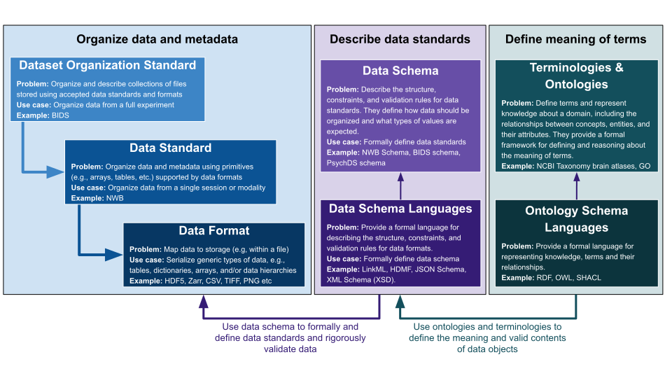

## Introduction

### Your responsibilities as PI of a BBQS project

All BBQS projects must upload their data to the EMBER Archive, with all datasets resulting from BBQS funding uploaded in accordance with the data management plan. Your NIH program officer can give you additional details about the required timing for your project.

In order to upload these datasets, your data will need to be formatted according to one or more of the BRAIN Initiative data standards. This guide describes the available data standards so that you can select the ones that are appropriate for your project. The BBQS Data Standards working group (authors of this guide) are also available to help you in selecting appropriate standards for your data - you can get in touch with us by writing to the data standards working group leads via [wg-chairs@brain-bbqs.org](mailto:wg-chairs@brain-bbqs.org).

We are aware that BBQS projects include data that is not yet published, human data (including personally identifying information), and other data that cannot be shared with the general public. The EMBER data archive is designed to securely store data at a number of different privacy levels, and both the [Ethics](https://brain-bbqs.org/working-groups/elsi/) working group and [EMBER team](https://emberarchive.org/about) are available to assist you in choosing the right ways of archiving your data.

### Glossary: What are data standards?

***Figure 1:*** Overview of key concepts in data standardization and their uses. (figure source: [guidelines-figures.pptx](https://github.com/brain-bbqs/bbqs-standards/blob/main/content/guidelines/figures/guidelines-figures.pptx))

**Data.** For the purposes of BBQS, the data you must upload includes, at a minimum [DEFINITION]. It should also include [DOCUMENTATION/METADATA.] In addition to these core requirements, you can also choose to include [OTHER EXAMPLES CHOSEN TO DRAW CONTRAST WITH WHAT IS REQUIRED.]

**Data standards** are agreed-upon conventions and guidelines that ensure consistency, compatibility, and interoperability of data across different systems and studies. They include specifications for data formats, metadata, dataset organization, and protocols to facilitate data sharing, integration, and reuse within the scientific community.

**Data formats** refer to the specific structure or encoding of data files that dictate how information is stored and represented. Common data formats in neuroscience include NIfTI for neuroimaging, HDF5 for hierarchical data, and CSV for tabular (row & column) data. A data standard may support multiple data formats for storage (e.g., NWB can use HDF5 or Zarr) or include files in different formats (e.g., a BIDS folder hierarchy may contain NIfTI, JSON, NWB, and other files). Choosing appropriate data formats is crucial for ensuring data accessibility and usability.

**Metadata** is ‘data about your data’ to define and enable interpretation of the data, e.g., defining the units of measurements, conversion factors, information about how data was acquired or generated etc.. Metadata is typically either stored directly as part of the data or alongside the data in the form of additional key-value files (JSON, YAML), tables (CSV, TSV), or structured documents (e.g., README files in Markdown).

**Dataset organization standards** are guidelines for organizing a collection of files. These conventions are designed to ensure consistency, compatibility, and interoperability of collections of files. They include specifications of required file and folder names, directory structure requirements, definition of permissible data standards and formats, and often also define additional metadata requirements for describing the dataset (e.g., via additional JSON and TSV files).

**Terminologies and ontologies** are structured vocabularies and frameworks that provide standardized terms and relationships to describe concepts within a domain. For example, naming conventions to describe brain locations using a brain atlas or terminology to describe the species of subjects (e.g., using the NCBI Taxonomy). Terminologies and ontologies are used in conjunction with data standards and help in categorizing and linking data, facilitating semantic interoperability, and enabling more effective data search and integration.

**Data archives** are specific storage locations designed for particular categories of data. They can be public or private (requiring specific credentials to access). The EMBER archive for BBQS (and other NIH neuroscience data archives) typically require that your data be formatted according to a specific data standard, dataset organizations, and include specific metadata about the data you deposit. Public, general-purpose data archives (e.g. FigShare, Open Science Framework) allow for any kinds of digital materials to be uploaded. For BBQS, general-purpose archives are mainly relevant for sharing auxiliary data (e.g., source code) that may not be supported by the EMBER archive.

## Main BBQS Data Standards

There are several key NIH Brain Initiative data standards that are relevant for BBQS. Each of these standards typically targets different types of experiments, e.g., neurophysiology (NWB), neuroimaging (BIDS), and psychology (PsychDS). Each of these standards also provides different capabilities for storing additional behavioral data. Depending on the data modalities used in an experiment, multiple data standards may be relevant and may need to be used in combination.

### Neurodata Without Borders (NWB): Neurophysiology and Behavior

**Overview:** NWB is a data standard for neurophysiology and behavior data, providing a common framework for storing and sharing data from various sources, including electrophysiology, optophysiology, and behavioral experiments. NWB uses HDF5 as its primary storage format, which allows for efficient storage and access of large, complex datasets (NWB also supports Zarr). Each NWB file describes one data collection session.

**Steps toward using the standard:** The NWB ecosystem offers various solutions for converting data to NWB, ranging from automated no-code tools to fine-grained programmatic options. For an overview of available tools for converting data to NWB see [here](https://neurodatawithoutborders.github.io/converting-data-to-nwb/). For a more detailed introduction to data conversion please see the [NWB data conversion user guide](https://nwb-overview.readthedocs.io/en/latest/conversion_tutorial/user_guide.html).

**Key Features:**

* Standardized schema for neurophysiology and associated behavioral data
* Support for multiple data modalities (electrophysiology, calcium imaging, behavior, etc.)
* Extensible framework for custom data types
* Integration with analysis tools and pipelines
* Comprehensive metadata support

**Resources:**

* Project website: [https://www.nwb.org/](https://www.nwb.org/)
* Getting started: [https://nwb-overview.readthedocs.io](https://nwb-overview.readthedocs.io)
* Core NWB software tools: [https://nwb.org/tools/core/](https://nwb.org/tools/core/)
* Tutorial for creating NWB extensions: [https://nwb-overview.readthedocs.io/en/latest/extensions_tutorial/extensions_tutorial_home.html](https://nwb-overview.readthedocs.io/en/latest/extensions_tutorial/extensions_tutorial_home.html)
* Policies and guidelines for creating an NWB Enhancement Proposal (NWBEP): [https://nwb.org/policies/](https://nwb.org/policies/)
* Storing behavioral data in NWB using: 1) [PyNWB (Python)](https://pynwb.readthedocs.io/en/latest/tutorials/domain/plot_behavior.html#sphx-glr-tutorials-domain-plot-behavior-py) and 2) [MatNWB (Matlab)](https://matnwb.readthedocs.io/en/latest/pages/tutorials/behavior.html):
* Video tutorials: [https://www.youtube.com/@NeurodataWithoutBorders/videos](https://www.youtube.com/@NeurodataWithoutBorders/videos)
* Example datasets: More than 390 datasets consisting of over 100,000 NWB files are available on the DANDI data archive

**Getting help:** For generic NWB-related questions use the [NWB Help Desk](https://github.com/NeurodataWithoutBorders/helpdesk/discussions). For specific questions and issues, open an [issue](https://docs.github.com/en/issues/tracking-your-work-with-issues/about-issues) on the relevant [NWB GitHub](https://github.com/NeurodataWithoutBorders) repositories. NWB also provides a [Slack](https://nwb-users.slack.com/join/shared_invite/zt-9bsx3xdj-wtUILLNzM8a0mOV_RywS~Q#/shared-invite/email) channel for community discussions and a [community mailing list](https://mailchi.mp/fe2a9bc55a1a/nwb-signup) for news and event updates.

### Brain Imaging Data Standard (BIDS): Dataset level standard covering Neuroimaging, Microscopy, Motion, Behavior and other data types

**Overview:** BIDS is a data standard for neuroimaging and behavioral data, providing a common framework for storing and sharing data from various sources, including functional magnetic resonance imaging (fMRI), structural MRI, and behavioral experiments. BIDS provides a standardized way of organizing and describing neuroimaging and behavioral data, facilitating data sharing and integration. Data from many sessions and participants can be organized into a single BIDS directory.

**Steps toward using the standard:** A collection of data follows the BIDS standard when all files (NIFTI, NWB, JSON, TSV) have been sorted into a required folder hierarchy and renamed following the BIDS pattern. You must add at least one metadata file (JSON format), and the resulting directory must pass the BIDS validator.

**Key Features:**

* File organization based on a consistent directory structure over existing data file standards (NIFTI, NWB, etc), and basic data formats (JSON, TSV)
* Simple file naming conventions that encode key metadata
* JSON-based metadata files that accompany data files
* Support for multiple imaging modalities (MRI, MEG, EEG, iEEG, PET, etc.)
* Standardized description of task events and behavioral data
* Validator tools to ensure compliance with the BIDS and incorporated (e.g. HED) standards

**Resources:**

* Project website: [https://bids.neuroimaging.io/](https://bids.neuroimaging.io/)
* BIDS GitHub Organization: [https://github.com/bids-standard](https://github.com/bids-standard)
* BIDS Specification: [https://bids-specification.readthedocs.io/en/stable/](https://bids-specification.readthedocs.io/en/stable/)
* BIDS Validator: [https://bids-standard.github.io/bids-validator/](https://bids-standard.github.io/bids-validator/)
* BIDS Extension Proposals: [https://bids.neuroimaging.io/get_involved.html#extending-the-bids-specification](https://bids.neuroimaging.io/get_involved.html#extending-the-bids-specification)
* Storing behavioral data in BIDS: [https://bids-specification.readthedocs.io/en/stable/modality-specific-files/behavioral-experiments.html](https://bids-specification.readthedocs.io/en/stable/modality-specific-files/behavioral-experiments.html)
* BIDS Apps (analysis pipelines that work with BIDS datasets): [https://bids-apps.neuroimaging.io/](https://bids-apps.neuroimaging.io/)

**Getting help:** For generic BIDS-related questions use the [NeuroStars](https://neurostars.org/tags/bids) Discourse Forum, under the `bids` tag. For specific questions and issues, open an [issue](https://docs.github.com/en/issues/tracking-your-work-with-issues/about-issues) on the relevant BIDS GitHub repositories.

### Psych-DS: Psychological Data and Behavior

**Overview:** Psych-DS is a BIDS-inspired data standard for psychological and behavioral data, providing a common framework for storing and sharing data from various sources, including psychological experiments, surveys, and behavioral assessments. PsychDS provides a standardized way of organizing and describing psychological and behavioral data, facilitating data sharing and integration. Like BIDS, a single PsychDS directory can contain data from many participants and sessions.

**Steps toward using the standard:** A collection of data follows the Psych-DS standard when all data tables have been moved into the data folder, converted to a standard CSV format, and renamed following the Psych-DS pattern. Unlike BIDS, Psych-DS allows any subfolder structure inside the data directory, but it only validates CSV files. You must add at least one metadata file (JSON format), and the resulting directory must pass the Psych-DS validator.

**Key Features:**

* Standardized directory structure similar to BIDS
* JSON-based metadata files for experiment and participant information
* Support for various types of psychological data (surveys, behavioral tasks, etc.)
* Compatibility with existing analysis tools
* Focus on human behavioral and psychological data

**Data Types Supported:**

* Questionnaire and survey data
* Behavioral task data
* Reaction time measurements
* Accuracy and performance metrics
* Psychophysical measurements
* Self-report measures
* Demographic information

**Resources:**

* Documentation: [https://psychds-docs.readthedocs.io/](https://psychds-docs.readthedocs.io/)
  * Psych-DS in 1 slide: [BBQS Brainhack 2025 Psych-DS](https://docs.google.com/presentation/d/1SiiBtvmmni_tmkNXvEZUaEJ-Rm0DD6ifgp-btg6G_rw/edit?usp=sharing)
* GitHub Repository: [https://github.com/psych-ds](https://github.com/psych-ds)
* Video introduction to Psych-DS: [https://www.youtube.com/watch?v=dnMW_xipxJo](https://www.youtube.com/watch?v=dnMW_xipxJo)
* Psych-DS CLI Validator: [https://github.com/psych-ds/psychds-validator](https://github.com/psych-ds/psychds-validator)
* Psych-DS Web Validator: [https://psych-ds.github.io/validator/](https://psych-ds.github.io/validator/)
* Example Datasets: [https://github.com/psych-ds/example-datasets](https://github.com/psych-ds/example-datasets)

**Getting help:** Open an issue on the relevant [PsychDS GitHub repository](https://github.com/psych-ds). If you’re not sure which repository to choose, or not familiar with using GitHub, you can also ask your question by clicking the “provide feedback” button on [the PsychDS validator](https://psych-ds.github.io/validator/) (this will open a new issue without you needing to make an account). You can also join the [PsychDS mailing list](https://goo.gl/forms/2dd6rouM1efJ3UBh2) to ask questions or contribute to the standard.

### Archive-specific Dataset Organizations

#### DANDI Layout

**Overview:** The DANDI layout for datasets comprised entirely of NWB files is BIDS-inspired but simplified.

* Each subject is contained in a folder named `sub-<subject_id>`
* Each session for a subject is an NWB file following the name pattern `sub-<subject_id>_ses-<session_id>_<modalities>.nwb`
* Allowed modalities are ecephys, icephys, ophys, behavior, image; if a file contains multiple modalities they are concatenated using the `+` character
* If splitting data for a single session into multiple NWB files (most common reason: separation of large raw data from small processed data), the additional field `desc-<string>` may be added, such as `sub-<subject_id>_ses-<session_id>_desc-raw_<modalities>.nwb`.
  The string may not include underscores.
* No other sidecar files (for example, custom .json metadata) are allowed.

For MRI or other BIDS-compliant modalities, any organizational layout that passes BIDS validation is allowed.

**Steps toward using the standard:** The [DANDI command line tools (DANDI-CLI)](https://dandi.readthedocs.io) include the [dandi-organize](https://dandi.readthedocs.io/en/latest/cmdline/organize.html) tool to help with organizing files in the DANDI layout. A collection of data follows the DANDI layout when all files have been moved to the appropriate folder, named according to the layout requirements and described via the required DANDI dataset metadata.

**Resources:**

* [DANDI User Guide](https://docs.dandiarchive.org/example-notebooks/dandi/DANDI%20User%20Guide%2C%20Part%20I/#uploading-to-dandi)

**Future:**

* [BEP032](https://github.com/bids-standard/bids-specification/pull/1705) introduces BIDS support for microephys, which allowed richer metadata customization for ecephys, icephys, and associated behavioral events data

## Recommendations for BBQS data

### Which standard should I use for my behavior data?

The choice of standard depends on the type of behavioral data and the recording technology used, and on how tightly coupled the behavioral data is to neural data recording/imaging streams.

Here are further recommendations for various types of behavioral data:

#### By Recording Technology

* **Video Recording**:
  * NWB: Store raw videos in standard formats (.mp4, .avi, . WMV, .mov, .flv, and .mkv) with links from NWB files.
  * Psych-DS: Store raw video in standard formats (.mp4, .avi, . WMV, .mov, .flv, .mkv etc.) in the ‘data/raw’ subfolder (automatically ignored from validation), OR add locations containing video and other non-CSV files to the .psychds-ignore file
  * BIDS:
    * for video stimuli - already basic support, [BEP044](https://bids.neuroimaging.io/extensions/beps/bep_044.html) aims to improve
    * for video of behaving subjects - see [bids-specification/issues/1771](https://github.com/bids-standard/bids-specification/issues/1771) for an intent for BEP and provided examples “in the wild”
* **Motion Capture Systems**:
  * NWB: Store motion capture data using appropriate [SpatialSeries](https://pynwb.readthedocs.io/en/latest/tutorials/domain/plot_behavior.html#sphx-glr-tutorials-domain-plot-behavior-py) objects or [https://github.com/rly/ndx-pose](https://github.com/rly/ndx-pose)
  * BIDS: Store motion capture data via [BIDS: Motion recording data](https://bids-specification.readthedocs.io/en/stable/modality-specific-files/motion.html).
  * Psych-DS: Store original tables as exported from the device or recording system in the ‘data/raw’ subfolder. Add versions to the data folder that comply with Psych-DS standard (file naming pattern, standardized CSV format) and include complete variable definitions in the dataset_description.json metadata file.
* **Eye Tracking**:
  * NWB: Store eye tracking data using [SpatialSeries](https://pynwb.readthedocs.io/en/latest/tutorials/domain/plot_behavior.html#sphx-glr-tutorials-domain-plot-behavior-py) for position data.
  * BIDS: [BEP020: Eye tracking](https://bids.neuroimaging.io/extensions/beps/bep_020.html%20)
  * Psych-DS: xyz
* **Wearable Sensors**:
  * NWB: Store time series data from wearable sensors using appropriate TimeSeries objects.
  * BIDS: Store wearable sensor data as [physiological recordings](https://bids-specification.readthedocs.io/en/stable/modality-specific-files/physiological-recordings.html) with appropriate metadata.
  * CSV (Psych-DS): Tabular data with “time stamp” and “time elapsed” columns.
* **GPS Tracking**:
  * NWB: Store GPS data using SpatialSeries objects.
  * BIDS: TODO - Is this supported? May be [BIDS: Motion](https://bids-specification.readthedocs.io/en/stable/modality-specific-files/motion.html), see [bids-specification/issues/2139](https://github.com/bids-standard/bids-specification/issues/2139)
* **Acoustic Recording**:
  * NWB: Store audio data using TimeSeries objects with appropriate rate and unit metadata.
  * BIDS: TODO - Is this supported? Similar to video recordings (see above)
* **Electromyography (EMG)**:
  * TODO - How to store?
  * Comment: [BIDS: BEP042](https://bids-website.readthedocs.io/en/latest/extensions/beps/bep_042.html) is working on support of surface EMG
* **Force Plates**:
  * TODO - How to store?
* **Virtual Reality (VR) Systems**:
  * TODO - How to store?
* **Behavioral Coding Software**:
  * TODO - How to store?
* **Automated Home Cage Monitoring**:
  * TODO - How to store?
* **Touchscreen-based Cognitive Testing**:
  * NWB: Store testing data using the ndx-structured-behavior extension.
    * Reference: [https://github.com/rly/ndx-structured-behavior](https://github.com/rly/ndx-structured-behavior)
  * BIDS: TODO - How to store?
  * PsychDS: TODO - How to store?
* **Infrared and Thermal Imaging**:
  * TODO - How to store?
* **Smart Devices and Mobile Apps**:
  * TODO - How to store?
* **Computerized Cognitive Testing**:
  * TODO - How to store?

#### By Behavior Type

* **Time series recordings of spatial positions** (e.g., eye or pupil tracking, subject position over time):
  * NWB: Store using appropriate [SpatialSeries](https://pynwb.readthedocs.io/en/latest/tutorials/domain/plot_behavior.html#) objects.
  * BIDS: TODO - How to store?
* **Video recordings for free-form behavior**:
  * NWB: Store raw videos in standard formats (e.g., MP4, AVI) that can be linked to from NWB as an [ImageSeries](https://pynwb.readthedocs.io/en/latest/tutorials/domain/images.html#external-files).
  * BIDS: TODO - How to store?
* **Motion tracking data** derived from video recordings (e.g., using DeepLabCut):
  * NWB: Store using the [ndx-pose extension](https://github.com/rly/ndx-pose).
  * BIDS: Store motion capture data via [motion recording data](https://bids-specification.readthedocs.io/en/stable/modality-specific-files/motion.html).
* **Locomotion and Movement data** (walking, running, swimming):
  * TODO - How to store?
* **Gait Analysis data** (stride length, step frequency):
  * TODO - How to store?
* **Posture and Balance data**:
  * TODO - How to store?
* **Eye Movements data** (saccades, fixations):
  * NWB: Store as [SpatialSeries for EyeTracking](https://pynwb.readthedocs.io/en/latest/tutorials/domain/plot_behavior.html#eyetracking-storing-continuous-eye-tracking-data-of-gaze-direction)
  * BIDS: TODO - How to store?
  * PsychDS: TODO - How to store?
* **Facial Expressions data**:
  * TODO - How to store?
* **Vocalizations and Speech data**:
  * NWB: Store audio data using TimeSeries objects with appropriate rate and unit metadata and annotate via TimeIntervals (e.g., to describe different parts of speech)
  * BIDS: TODO - How to store?
  * PsychDS: TODO - How to store?
* **Experiments involving structured behavioral tasks**:
  * NWB: Store using the [ndx-structured-behavior extension](https://github.com/rly/ndx-structured-behavior).
  * BIDS: Store following the BIDS specification for [behavioral experiments](https://bids-specification.readthedocs.io/en/stable/modality-specific-files/behavioral-experiments.html).
  * PsychDS: TODO - How to store?
* **Social Interactions data**:
  * TODO - How to store?
* **Feeding and Drinking behavior**:
  * TODO - How to store?
* **Emotional and Stress Responses**:
  * TODO - How to store?
* **Sleep and Rest data**:
  * NWB: Store using [TimeIntervals](https://pynwb.readthedocs.io/en/stable/tutorials/general/plot_timeintervals.html) for sleep stages and appropriate TimeSeries for physiological measurements.
  * BIDS: TODO - How to store?
  * PsychDS: TODO - How to store?
* **Operant Conditioning and Learning data**:
  * TODO - How to store?
* **Physical Activity Levels**:
  * TODO - How to store?
* **Event-based data** is supported in both NWB and BIDS:
  * BIDS: Store following the BIDS specification for [task events](https://bids-specification.readthedocs.io/en/stable/modality-specific-files/task-events.html).
  * NWB provides several mechanisms for storing event-based data:
    * [TimeIntervals](https://pynwb.readthedocs.io/en/stable/tutorials/general/plot_timeintervals.html) allow annotation of ranges in time, e.g., to define trials
    * TimeSeries allow continuous recording of events
    * The [ndx-events extension](https://github.com/rly/ndx-events) is designed specifically for event data.
  * PsychDS: TODO - How to store?
* **Pain and Discomfort Indicators**:
  * PsychDS: For psychological studies of pain and discomfort. See [https://psychds-docs.readthedocs.io/](https://psychds-docs.readthedocs.io/)
  * BIDS: TODO - How to store?
  * NWB: TODO - How to store?
* **Reproductive Behaviors**:
  * TODO - How to store?

### Which standard should I use for my neural data?

The choice of standard for neural data depends on the recording technology and the type of neural data collected. Here are recommendations for various types of neural data:

#### Electrophysiology Data

* **Single-unit and Multi-unit Recordings**:
  * NWB is the recommended standard for storing spike times, waveforms, and related metadata.
    * TODO - Link to NWB electrophysiology tutorial
* **Local Field Potentials (LFPs)**:
  * NWB is the recommended standard for storing LFP data, with appropriate metadata about electrode locations and recording parameters.
    * Reference: [https://pynwb.readthedocs.io/en/stable/tutorials/domain/ecephys.html#lfp](https://pynwb.readthedocs.io/en/stable/tutorials/domain/ecephys.html#lfp)
* **Patch Clamp Recordings**:
  * NWB is the recommended standard for storing intracellular electrophysiology data, including voltage and current recordings.
    * Reference: [https://pynwb.readthedocs.io/en/stable/tutorials/domain/plot_icephys.html](https://pynwb.readthedocs.io/en/stable/tutorials/domain/plot_icephys.html)
* **EEG/MEG Data**:
  * BIDS is recommended for standalone EEG/MEG studies.
    * Reference: [https://bids-specification.readthedocs.io/en/stable/modality-specific-files/electroencephalography.html](https://bids-specification.readthedocs.io/en/stable/modality-specific-files/electroencephalography.html)
  * NWB can be used for studies combining EEG/MEG with other neural recordings by storing EEG/MEG as ElectricalSeries.
    * TODO - Link to NWB electrophysiology tutorial

#### Imaging Data

* **Functional MRI (fMRI)**:
  * BIDS is the recommended standard for storing fMRI data, with appropriate metadata about scanning parameters and experimental design.
    * Reference: [https://bids-specification.readthedocs.io/en/stable/modality-specific-files/magnetic-resonance-imaging-data.html](https://bids-specification.readthedocs.io/en/stable/modality-specific-files/magnetic-resonance-imaging-data.html)
* **Structural MRI**:
  * BIDS is the recommended standard for storing structural MRI data, with appropriate metadata about scanning parameters.
    * Reference: [https://bids-specification.readthedocs.io/en/stable/modality-specific-files/magnetic-resonance-imaging-data.html](https://bids-specification.readthedocs.io/en/stable/modality-specific-files/magnetic-resonance-imaging-data.html)
* **Calcium Imaging (e.g., One-Photon, Two-Photon)**:
  * NWB is the recommended standard for storing calcium imaging data, with appropriate metadata about imaging parameters and ROIs.
    * Reference: [https://pynwb.readthedocs.io/en/stable/tutorials/domain/ophys.html](https://pynwb.readthedocs.io/en/stable/tutorials/domain/ophys.html)

#### Other Neural Data

* **Optogenetic Stimulation**:
  * NWB is the recommended standard for storing optogenetic stimulation parameters and related data.
    * TODO - Link to NWB optogenetics tutorial
* **Electrical Stimulation**:
  * NWB is the recommended standard for storing electrical stimulation parameters and related data.
    * TODO - Link to NWB electrophysiology tutorial
* **Intracranial EEG (iEEG)**:
  * BIDS is recommended for standalone iEEG studies.
    * Reference: [https://bids-specification.readthedocs.io/en/stable/modality-specific-files/intracranial-electroencephalography.html](https://bids-specification.readthedocs.io/en/stable/modality-specific-files/intracranial-electroencephalography.html)
  * NWB can be used for studies combining iEEG with other neural recordings.
* **PET Imaging**:
  * BIDS is the recommended standard for storing PET imaging data, with appropriate metadata about scanning parameters
    * Reference: [https://bids-specification.readthedocs.io/en/stable/modality-specific-files/positron-emission-tomography.html](https://bids-specification.readthedocs.io/en/stable/modality-specific-files/positron-emission-tomography.html)

### What do I do if my data is not supported by any of the recommended data standards?

If you are unsure how to decide on the best option, the [BBQS Data Coordination and Artificial Intelligence Center (DCAIC)](https://brain-bbqs.org/about/) is happy to help. You can contact the DCAIC team via [dcaic-admin@brain-bbqs.org](mailto:dcaic-admin@brain-bbqs.org). The DCAIC team also hosts regular [working group meetings](https://brain-bbqs.org/working-groups/) on Analytics, Devices, Ethics, Legal, and Standards. For questions specific to topics covered by the working groups, you may also want to contact the [working group leads](https://brain-bbqs.org/working-groups/). For issues specific to the [EMBER data archive](https://emberarchive.org/), you may also reach out to the EMBER team.

NWB, BIDS and Psych-DS already support a variety of mechanisms that enable users to define experiment-specific metadata and data and definition of new data types not yet supported by the standards. In particular if your data generally fits one of these standards but just requires a few additional fields, exploring the existing options described below is likely a good option.

If your data defines a data modality not yet supported by any of the existing types, it is generally recommended to reach out to the DCAIC team or individual data standards teams via their help desks to see if options are already being developed and to help decide on the best course for integrating your new data.

#### NWB: Mechanisms for integrating new data types

NWB supports a variety of options for integrating custom metadata and new data types. The appropriate mechanism depends on the level of formal rigor, support, and broad applicability of the type of data. The following options are roughly sorted from least to most rigorous:

* **Custom table columns:** NWB uses tables (called *DynamicTable* in NWB) for storing a large variety of metadata, e.g.,: 1) definition and annotation of time intervals, e.g., epoch, trials, or other ranges in time, 2) definition of event-based data, or 3) metadata about recording devices, e.g., extracellular electrodes, or 4) experiment descriptions for intracellular recordings. NWB supports inclusion of custom, user-defined data columns within table data. If the data you need to add is experiment-specific and is logically associated with any of the existing types of data tables, then adding the data as custom data columns may be a good option.
* **Generic TimeSeries:** NWB defines a generic base type for arbitrary time series data. This option provides great flexibility for including custom time-series-type measurements.
* **Issues/Pull Requests:** Smaller corrections or enhancements of existing types in the NWB schema (e.g., addition of optional attributes to further refine a type) can also be proposed directly via issues or pull requests on the [nwb-schema GitHub repository](https://github.com/NeurodataWithoutBorders/nwb-schema/), if changes are small enough to not require a larger effort of a full NWB Enhancement Proposal (NWBEP).
* **Neurodata Extensions (NDX):** NWB supports integration of new data types and lab-specific data via extensions, referred to as Neurodata Extensions (NDX). NDX can be used and shared directly via NWB files and the [NWB Extension Catalog](https://nwb-extensions.github.io/). Extensions provide a powerful mechanism for users to integrate new data with NWB and make the data immediately accessible. The NWB community has already created a variety of extensions, so before creating your own new extension, take a look at the [NWB Extension Catalog](https://nwb-extensions.github.io/) to see if an existing extension may already exist for your data. To learn how to create an NDX extension for NWB, see the [tutorial on extending NWB](https://nwb-overview.readthedocs.io/en/latest/extensions_tutorial/extensions_tutorial_home.html).
* **NWB Enhancement Proposal (NWBEP):** Users can also create [NWB Enhancement Proposals (NWBEPs)](https://github.com/nwb-extensions/nwbep-review/) to propose the integration of extensions with the NWB core data standard. This process involves creating an enhancement proposal and engaging with the NWB community via the NWB Technical Advisory Board (TAB) for feedback and approval.

#### BIDS: Mechanisms for integrating new data types

* **Custom metadata fields**: You can create custom fields in JSON sidecar and columns in relevant (participants, events, channels, etc) TSV files to include additional metadata. Ensure that the custom fields in JSON files are clearly named to avoid conflicts with existing BIDS fields. Additional columns in the TSV files are advised to be provided description, with potential controlled vocabulary set of values and linking to external resources in their sidecar JSON files.
* **Pull Requests:** Additional file formats, entities, metadata fields and alike could be proposed to extend already present modalities, if changes are small enough to not require a larger effort of BEP.
* [**BIDS Extension Proposal (BEP)**](https://bids-specification.readthedocs.io/en/stable/extensions.html): BIDS has a mechanism for extensions, which are community-driven proposals to add new modalities, data types, and associated metadata fields. If your custom data might benefit others, consider proposing a BIDS extension. This process involves creating an extension proposal and engaging with the BIDS community for feedback and approval. See “[BEP Process](https://bids.neuroimaging.io/extensions/process.html)” ([https://bids.neuroimaging.io/extensions/process.html](https://bids.neuroimaging.io/extensions/process.html)) section for guidance.
* [**Unspecified data**](https://bids-specification.readthedocs.io/en/stable/common-principles.html#unspecified-data)**:** According to the BIDS common principles: “*Additional files and directories containing raw data MAY be added as needed for special cases. All non-standard file entities SHOULD conform to BIDS-style naming conventions, including alphabetic entities and suffixes and alphanumeric labels/indices. Non-standard suffixes SHOULD reflect the nature of the data, and existing entities SHOULD be used when appropriate*.”
* **Custom TimeSeries in NWB:** For larger binary, time series data, another option may be to store the data in NWB and then link it in BIDS. BIDS already supports inclusion of NWB files for select (iEEG) data modalities.

#### PsychDS: Mechanisms for integrating new data types

* PsychDS accommodates any data that is stored in rows and columns (tabular data). It does not currently provide specific formatting or requirements for particular subfields, methods, or behavior types. Instead, every field/column is essentially a ‘custom’ field, and it is up to the researcher to clearly name and define all fields in the primary JSON metadata file.
* If you have a series of fields (names, definitions, type or value restrictions) that you believe would be of benefit to a larger community, we are currently developing an extension process - for now, please open an issue as described in the “getting help” section.

### Additional recommendations

* **Use of Hierarchical Event Descriptors (HED)** is recommended for annotating events in both BIDS and NWB datasets. HED provides a standardized vocabulary for describing events in neuroscience experiments, facilitating data integration and analysis.
  * Reference:
    * **Docs:** [https://www.hedtags.org/](https://www.hedtags.org/)
    * **Making HED meaningful:** [https://www.hedtags.org/hed-resources/HedAnnotationSemantics.html](https://www.hedtags.org/hed-resources/HedAnnotationSemantics.html)
  * **Integrations with Standards:**
    * BIDS: [https://bids-specification.readthedocs.io/en/stable/appendices/hed.html](https://bids-specification.readthedocs.io/en/stable/appendices/hed.html)
    * NWB: [https://www.hedtags.org/ndx-hed/](https://www.hedtags.org/ndx-hed/)

* **Use of standardized terminologies and ontologies** is recommended for describing experimental metadata, such as species, brain regions, and cell types. This facilitates data integration and search across datasets.
  * NCBI Taxonomy for species: [https://www.ncbi.nlm.nih.gov/taxonomy](https://www.ncbi.nlm.nih.gov/taxonomy)
  * Allen Brain Atlas for brain regions: [https://atlas.brain-map.org/](https://atlas.brain-map.org/)
  * Cell Type Ontology for cell types: [https://obofoundry.org/ontology/cl.html](https://obofoundry.org/ontology/cl.html)

* **Combining multiple standards** may be necessary for complex experiments that involve multiple data modalities. For example, a study that includes both neuroimaging and electrophysiology data may use BIDS for the neuroimaging data and NWB for the electrophysiology data, with appropriate links between the two.
  * There are also some ongoing efforts to support integration of BIDS and NWB, e.g., [BEP32](https://bids.neuroimaging.io/extensions/beps/bep_032.html), which supports storing mircoelectrode electrophysiology data in NWB files as part of BIDS.

* **Data validation** is recommended to ensure compliance with the chosen standard. Most standards provide validation tools that can be used to check if a dataset conforms to the standard.
  * BIDS Validator: [https://bids-standard.github.io/bids-validator/](https://bids-standard.github.io/bids-validator/)
  * NWB Inspector: [https://github.com/NeurodataWithoutBorders/nwbinspector](https://github.com/NeurodataWithoutBorders/nwbinspector)
  * PsychDS CLI Validator: [https://github.com/psych-ds/psychds-validator](https://github.com/psych-ds/psychds-validator)
  * PsychDS Web Validator: [https://psych-ds.github.io/validator/](https://psych-ds.github.io/validator/)

* **Documentation and metadata** are crucial for ensuring that data can be understood and reused by others. Include detailed descriptions of experimental design, data collection methods, and analysis procedures.

* **Data sharing and publication** BBQS data should be published via the [EMBER](https://emberarchive.org/) data archive.

* **Community engagement** is encouraged to contribute to the development and improvement of data standards. Join mailing lists, attend workshops, and participate in discussions to stay informed about updates and best practices.
  * NWB Community: See the [https://www.nwb.org/](https://www.nwb.org/) or [volunteer](https://forms.gle/Bf8pZiF62KPYthdm9) for community activities
  * BIDS Community: [https://bids.neuroimaging.io/get_involved.html](https://bids.neuroimaging.io/get_involved.html)

* **Data should be described by formal data schemas.** Data Schemas are used to formally describe the structure, constraints, and validation rules for data standards. They define how data should be organized and what types of values are expected. All main BBQS standards are governed by formal data schema (e.g., the [NWB Schema](https://nwb-schema.readthedocs.io/), [BIDS Schema](https://bids-specification.readthedocs.io/en/stable/appendices/schema.html), or [PsychDS Schema](https://github.com/psych-ds/psych-DS)) and fulfill this guidance.
  * As described above, some data standards also support inclusion of custom metadata fields or columns in data tables via various mechanisms. To ensure compliance, such custom fields are often required to be described via formal schema extensions or via (simpler) data field descriptors. **Data Field Descriptors** are a specific kind of metadata stored alongside the data (often as dictionaries) and are used to define the meanings of individual columns/fields within the data, and provide important parameters such as data type (integer, string, factor), minimum and maximum values, and missing values.

* **Data schema should be defined via formal data schema languages.** Data Schema Languages provide a formal mechanism for describing the structure, constraints, and validation rules for data formats, and are used to formally define data schema. Depending on the data format or use case, different schema languages may be appropriate, e.g., JSON Schema, XML Schema, LinkML or HDMF. For example, NWB uses the HDMF schema language, BIDS uses a custom YAML-based language, and PsychDS uses LinkML.

* **How do I manage large collections of data?**
  * **Large-scale recordings (e.g., 100+ GB NWB files)**: Store the raw and processed data in separate NWB files, and use the same metadata between the files
  * **Continuous, multi-day data collection:** Breaking up recordings across files (e.g, per day) is recommended if single files become too large. Smaller data, e.g., annotations may be more naturally stored in a single separate file to simplify analysis. To provide context, relevant parts of the smaller data may be duplicated in the subset files, e.g., including annotations for a particular day also in the corresponding neural data file for that day.
